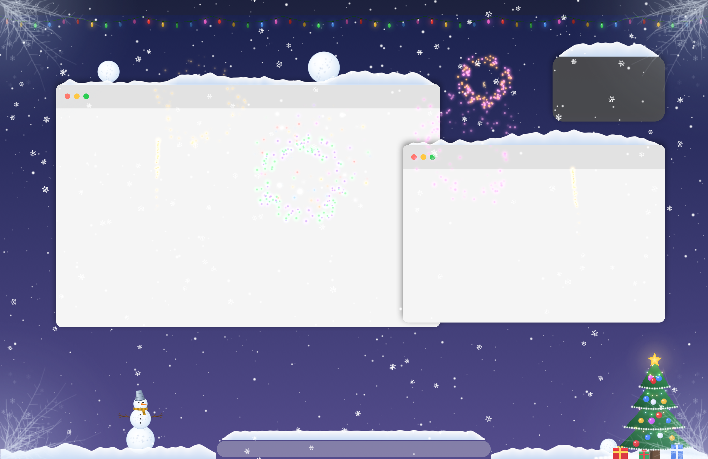
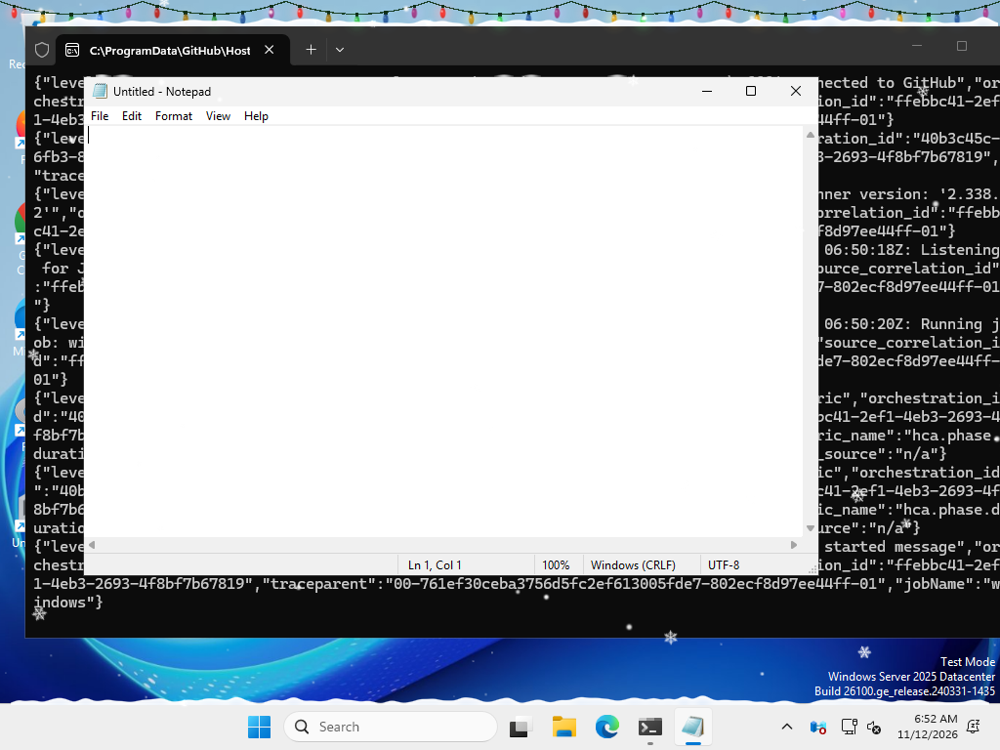
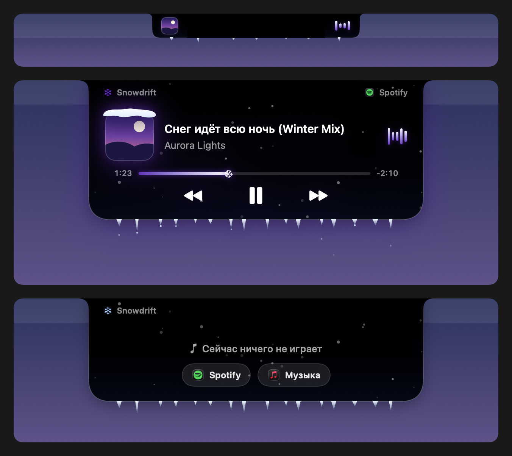

# Snowdrift ❄️

Снег на рабочем столе **macOS и Windows** — бесплатно, с открытым кодом и без рекламы.



Снежинки падают поверх экрана и собираются в сугробы на окнах, на Dock или панели задач и внизу экрана. Сдвиньте окно — сугроб поедет вместе с ним; резко дёрните — снег слетит. Из снега можно скатать снежки и слепить снеговика, запустить салют, а у «чёлки» (или вверху экрана на Windows) живёт снежный остров с музыкой.

<details>
<summary>Так это выглядит на настоящем Windows (снимок с проверочной машины GitHub)</summary>



</details>

## Установить или обновить одной командой

**Windows** — откройте PowerShell (`Win+X` → «Терминал») и вставьте:

```powershell
irm https://raw.githubusercontent.com/Ayanokoji771/snowdrift/main/install.ps1 | iex
```

**macOS** — откройте «Терминал» и вставьте:

```bash
curl -fsSL https://raw.githubusercontent.com/Ayanokoji771/snowdrift/main/install.sh | bash
```

Одна и та же команда и ставит Snowdrift, и обновляет его до последней версии. Она скачивает выпуск с GitHub, сверяет контрольную сумму SHA-256, кладёт программу на то же место, где она уже стоит, и запускает её. Настройки и автозапуск сохраняются, права администратора не нужны. Что именно делает команда, видно в [install.ps1](install.ps1) и [install.sh](install.sh).

## Скачать

| Система | Файл |
| --- | --- |
| **Windows 10 / 11** (обычные ноутбуки и ПК) | [Snowdrift-Windows-x64.zip](https://github.com/Ayanokoji771/snowdrift/releases/latest/download/Snowdrift-Windows-x64.zip) |
| Windows на ARM (Snapdragon) | [Snowdrift-Windows-ARM64.zip](https://github.com/Ayanokoji771/snowdrift/releases/latest/download/Snowdrift-Windows-ARM64.zip) |
| **macOS 14+** (Apple Silicon и Intel) | [Snowdrift-macOS.zip](https://github.com/Ayanokoji771/snowdrift/releases/latest/download/Snowdrift-macOS.zip) |

Все версии — на странице [Releases](https://github.com/Ayanokoji771/snowdrift/releases).

### Установка на Windows

1. Скачайте `Snowdrift-Windows-x64.zip` и распакуйте его. Внутри один файл — `Snowdrift.exe`, установка не нужна.
2. Переложите `Snowdrift.exe` туда, где он будет жить (например, в `Документы\Snowdrift`), и запустите.
3. Windows покажет синее окно «Система Windows защитила ваш компьютер»: нажмите **«Подробнее» → «Выполнить в любом случае»**. Так Windows встречает любую программу без платной подписи Microsoft; это нужно один раз.
4. Снег пойдёт сразу. Настройки — значок снежинки в трее (справа внизу, возможно под стрелкой ^). Чтобы снег запускался сам, включите в меню «Запускать вместе с Windows».

Если в Windows 11 включено «Интеллектуальное управление приложениями» (Smart App Control), Windows не даст запустить программу без подписи. Проверить: «Безопасность Windows» → «Управление приложениями и браузером».

### Установка на macOS

1. Скачайте `Snowdrift-macOS.zip`, распакуйте и перетащите **Snowdrift.app** в «Программы».
2. При первом запуске macOS скажет, что не может проверить разработчика. Откройте «Системные настройки» → «Конфиденциальность и безопасность» и нажмите **«Всё равно открыть»**. Или в Терминале:
   ```bash
   xattr -cr /Applications/Snowdrift.app
   ```
3. Настройки — снежинка в строке меню.

## Обновление

Snowdrift обновляется сам. Раз в день он узнаёт у GitHub, нет ли новой версии. Если есть, он сам её скачивает, сверяет контрольную сумму SHA-256 (файл `SHA256SUMS.txt` в каждом выпуске) и ставит на место старой. Перезапускается Snowdrift тогда, когда вы три минуты не трогаете компьютер, поэтому работе это не мешает. Настройки и автозапуск сохраняются.

- **Кнопка «⬆ Обновить Snowdrift»** всегда стоит первой в меню (снежинка в трее или в строке меню). Один клик — и Snowdrift проверит GitHub, обновится и перезапустится.
- Выключить автообновление: меню → «Обновления» → «Обновлять автоматически».
- Из терминала обновляет та же команда, что и ставит (см. выше).
- В версиях 1.0.0–1.1.1 кнопки ещё нет или она спрятана. Выполните команду установки один раз, и она заменит старую версию на месте.

## Возможности

- **Сугробы** на верхних краях окон, на Dock / панели задач и внизу экрана. Снег мягко оседает и осыпается с краёв. Снег не ложится на части окон, закрытые другими окнами; у свёрнутых окон и окон на других рабочих столах сугроб сохраняется, у закрытых — осыпается. Когда Dock или панель задач прячется (полный экран, автоскрытие), их сугроб ждёт их возвращения.
- **Варежка**: проведите курсором по сугробу — снег разлетится. Курсор раздувает и падающие снежинки.
- **Снежки и снеговики** («Курсор → Снежки»): водите курсором по сугробу — скатается снежок; толкайте его, и он покатится и вырастет. Возьмите снежок мышкой и положите на другой: два шара — снеговик с морковкой, шарфом и руками-ветками, три — ещё и с ведром или цилиндром.
- **Погода**: лёгкий снег, ровный снегопад или метель; мелкие, обычные или крупные снежинки; ветер в любую сторону с порывами.
- **Снежный остров 🎵** — музыка в стиле Dynamic Island:

  

  - пока играет музыка, рядом с «чёлкой» (на Windows — вверху по центру) видны обложка и снежный эквалайзер;
  - наведите курсор — остров плавно раскроется: обложка с шапкой снега, название бегущей строкой, исполнитель, ледяная полоска прогресса со снежинкой (нажмите, чтобы перемотать), кнопки ⏮ ⏯ ⏭;
  - внутри идёт снег, снизу висят сосульки, с них капает; свечение подстраивается под цвет обложки;
  - на новом треке остров «выдыхает» облачко снега, и снежинки ложатся на окна;
  - macOS: Spotify и «Музыка». Windows: любой плеер, который показывает себя в системных медиа-кнопках — Spotify, браузеры (YouTube, VK, Яндекс Музыка в браузере), Apple Music, «Медиаплеер» и другие.
- **Новогоднее 🎄**: салют по кнопке и сам собой в новогоднюю полночь; ёлка с игрушками, огоньками, звездой и подарками; гирлянда (горит, мерцает, бегущие огни); иней по углам; искрящийся снег.
- **Плавные жесты как на Mac ✋** (Windows, сенсорная панель):
  - свайп четырьмя (или тремя) пальцами вбок — соседний рабочий стол едет вслед за пальцами и мягко докатывается на пружинке; короткий быстрый взмах тоже переключает, а у крайнего стола экран тянется, как резинка, и возвращается;
  - свайп вниз — все окна плавно уменьшаются и уходят в панель задач; свайп вверх — возвращаются на место (если окна и так открыты — открывается «Представление задач»);
  - Snowdrift только показывает анимацию, а переключает сама Windows, поэтому всё работает как обычно: окна, панель задач, горячие клавиши;
  - как включить: в меню Snowdrift откройте «Плавные жесты как на Mac ✋» → «Включить: отключить жесты Windows…». Чтобы один свайп не делал два дела сразу, в «Параметры → Bluetooth и устройства → Сенсорная панель → Жесты четырьмя пальцами → Прокрутка» нужно выбрать «Ничего». Snowdrift сам откроет это место, и жесты заработают сразу.
- **Оттепель**: сугробы и снеговики понемногу тают.
- **Глубина**: дальние снежинки идут «за» окнами, ближние — перед ними.
- **Счётчики**: сколько дней до Нового года и сколько снежинок уже улеглось.
- **Не мешает работать**:
  - клики проходят сквозь снег (кроме момента, когда вы берёте снежок);
  - над полноэкранными приложениями, играми и видео снег прячется сам (можно оставить или прятать ещё и над развёрнутыми окнами);
  - «Прятать снег над всеми приложениями» — снег только на рабочем столе, с исключениями;
  - «Прятать снег над приложениями» — список открытых программ с галочками;
  - снег плавно исчезает и появляется и продолжает падать, пока скрыт; в режиме энергосбережения рисуется легче;
  - «Пауза на 1 час».

### Быстрые клавиши (работают в любом приложении)

| macOS | Windows | Что делают |
| --- | --- | --- |
| ⌃⌥S | Ctrl+Alt+S | включить или выключить снег |
| ⌃⌥A | Ctrl+Alt+A | прятать снег над всеми приложениями (только рабочий стол) |
| ⌃⌥H | Ctrl+Alt+H | спрятать или вернуть снег над текущим приложением |
| ⌃⌥D | Ctrl+Alt+D | убрать весь снег |
| ⌃⌥F | Ctrl+Alt+F | салют |

## Приватность

- Никаких аккаунтов, ключей, аналитики и рекламы.
- Snowdrift читает только **границы** окон (положение и размер), а не их названия и содержимое. Никаких разрешений на запись экрана или «Универсальный доступ».
- **Windows**: в интернет Snowdrift выходит только для того, чтобы раз в день спросить у GitHub, нет ли новой версии (выключается в меню «Обновления»). Обложки трека отдаёт сам плеер через системные медиа-кнопки.
- **macOS**: в интернет Snowdrift выходит только за обложкой трека Spotify (меню → «Снежный остров» → «Обложки Spotify») и раз в день на GitHub за проверкой обновлений (меню → «Обновления»). И то и другое можно выключить. Для кнопок плеера macOS один раз спросит разрешение на управление Spotify или «Музыкой».
- **Жесты (Windows)**: Snowdrift видит только положение пальцев на сенсорной панели, пока вы ей пользуетесь, и ничего не сохраняет. Окна во время анимации рисует сама Windows (так же, как превью в Alt+Tab), и Snowdrift их не получает.
- Настройки хранятся только на вашем компьютере: macOS — `UserDefaults`, Windows — `%APPDATA%\Snowdrift\settings.json`.
- Все картинки (снежинки, снеговик, ёлка, иконка) рисуются кодом — в приложении нет чужих ресурсов.

## Сборка

### macOS

Нужны macOS 14+ и Xcode или Command Line Tools.

```bash
./build.sh            # build/Snowdrift.app (Apple Silicon + Intel)
./build.sh --install  # и установить в «Программы»
```

Проверки без экрана: `build/bin/Snowdrift --selftest`, `--snapshot preview.png`, `--island-preview island.png`.

### Windows

Нужен [.NET 8 SDK](https://dotnet.microsoft.com/download/dotnet/8.0).

```powershell
dotnet publish windows/Snowdrift.Windows.csproj -c Release -r win-x64 --self-contained -p:PublishSingleFile=true -p:IncludeNativeLibrariesForSelfExtract=true -o out
```

Проверки: `Snowdrift.exe --selftest out.txt`, `--snapshot snow.png`, `--island-preview island.png`. Отладка живого приложения: переменная окружения `SNOWDRIFT_DEBUG=папка` — каждые 10 секунд лог и картинка того, что видит каждый экран.

### GitHub Actions

Каждый push собирает обе версии на настоящих macOS и Windows, прогоняет самопроверку, рисует картинки и запускает приложение на рабочем столе Windows. Тег `v*` публикует релиз с готовыми архивами.

## Как устроено

| macOS (Swift) | Windows (C#) | Что делает |
| --- | --- | --- |
| `Simulation.swift` | `Simulation.cs` | Снежинки (3 слоя глубины), сугробы как карты высот по 2 pt, осыпание, курсор, снежки, снеговики, гирлянда, оттепель |
| `Festive.swift` | `Festive.cs` | Салют, ёлка с подарками, иней |
| `WindowTracker.swift` | `WindowTracker.cs` | Границы окон, Dock / панель задач, полноэкранный режим |
| `Renderer.swift` (Metal) | `Renderer.cs` (Direct3D 11) | Один проход: все спрайты и сугробы одним вызовом отрисовки |
| `Atlas.swift` | `Atlas.cs` | Рисует все текстуры кодом при запуске |
| `Overlay.swift` | `Overlay.cs` (DirectComposition) | Прозрачное окно поверх экрана, пропускающее клики |
| `Music.swift`, `Island.swift` (SwiftUI) | `Music.cs`, `Island.cs` (WPF) | Снежный остров с музыкой |
| `AppDelegate.swift` | `App.cs` | Меню, настройки, горячие клавиши, автозапуск |
| — | `Touchpad.cs`, `Gestures.cs`, `Motion.cs` | Жесты: пальцы через Raw Input, пружина и резинка, рабочие столы, превью окон через DWM |

## Лицензия

MIT — см. [LICENSE](LICENSE).

---

**English:** Snowdrift puts snow on your macOS or Windows desktop: it piles up on windows, the Dock/taskbar and the bottom of the screen, rides along when you move windows, and flies off when you yank them. Roll snowballs into snowmen, launch fireworks, enjoy a tree, garland and frost, and control music from a snowy Dynamic-Island-style widget. On Windows laptops, Mac-smooth touchpad gestures slide virtual desktops with your fingers on a soft spring and tuck windows into the taskbar. Free, open source (MIT), no accounts or analytics. Downloads are on the [Releases](https://github.com/Ayanokoji771/snowdrift/releases) page.
